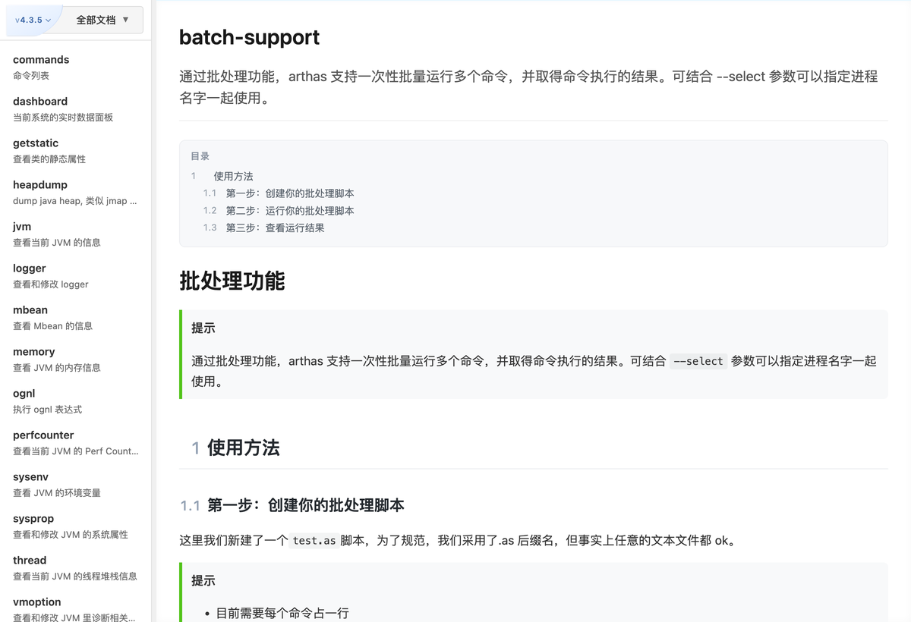
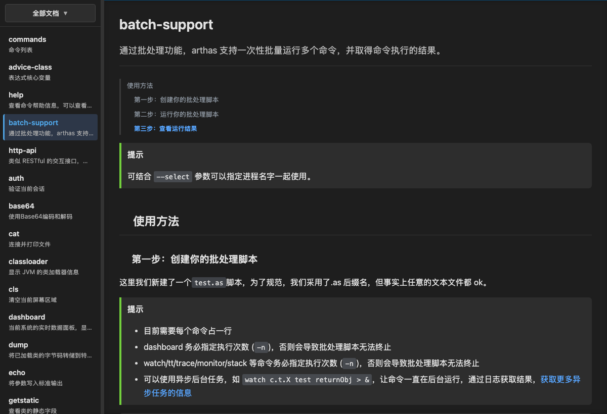

# uTools Arthas Docs

在 [uTools](https://u.tools/) 里**离线**查阅 [Alibaba Arthas](https://arthas.aliyun.com/) 命令文档的插件。

收录 Arthas 4.3.5 全量文档（76 篇），并保留 4.1.3 旧版文档（50 篇），覆盖全部命令、表达式核心变量、HTTP API、批处理、鉴权、JVM 相关工具等；无需联网，输入关键词即可秒开，左上角还可一键切换文档版本。

[](LICENSE)
[](https://github.com/oxyuan/utools-arthas-docs-plugin/actions/workflows/check.yml)
[](https://u.tools/)
[](https://arthas.aliyun.com/doc/)
[](https://nodejs.org/)

> ⚠️ 本项目是**非官方**项目，与阿里巴巴集团及 Arthas 团队无关，详见文末「声明与致谢」。

## ✨ 功能特性

- **完整文档**：4.3.5 共 76 篇、4.1.3 共 50 篇 Markdown 文档，含全部 Arthas 命令与高级功能说明
- **多版本切换**：左上角斜切角标显示当前版本，悬停展开即可切到其他版本文档
- **完全离线**：文档随插件打包，无网络请求，内网环境也能用
- **阅读体验**
  - 每篇文档顶部自动生成目录，`1 / 1.1 / 1.1.1` 多级编号体现层级，点击跳转、滚动高亮当前章节
  - 站内交叉引用（文档里的 `/doc/xxx.md` 链接）直接在插件内切换，不跳出插件
  - 代码块语法高亮 + 一键复制，命令行里直接粘贴
  - 自动适配系统暗色模式
- **查找方便**：左侧文档列表 + 分组筛选（命令列表 / 使用指南），侧边栏宽度可拖动调整
- **触发简单**：关键词 `arthas`、`docs`、`java诊断` 都可以唤起

## 🖼️ 界面预览

| 亮色主题 | 暗色主题 |
| --- | --- |
|  |  |

## 📦 安装

**方式一：uTools 应用市场**

在 uTools 搜索框输入 `arthas`、`docs` 或 `java诊断`，在「插件应用市场」中安装；也可以直接在应用市场里搜索本插件。

**方式二：离线安装**

从 [Releases](https://github.com/oxyuan/utools-arthas-docs-plugin/releases) 下载 `.upx` 文件，拖入 uTools 窗口即可安装。

## 📋 文档列表

文档按版本分目录存放（`plugin/docs/<version>/`），每个版本各有一份 `docs-list.json`（菜单顺序与描述）、
`docs-group.json`（分组）和 `README.md`（索引）。左侧下拉按分组筛选，4.3.5 的分组如下：

| 分类 | 篇数 | 文档 |
| --- | --- | --- |
| 命令列表 | 50 | `commands` `dashboard` `getstatic` `heapdump` `jvm` `logger` `mbean` `memory` `ognl` `perfcounter` `sysenv` `sysprop` `thread` `vmoption` `vmtool` `classloader` `classloader-metaspace` `dump` `jad` `mc` `redefine` `retransform` `sc` `sm` `monitor` `line` `stack` `trace` `tt` `watch` `profiler` `jfr` `auth` `options` `external-command` `grep` `base64` `cat` `cls` `echo` `help` `history` `keymap` `pwd` `quit` `reset` `session` `stop` `tee` `version` |
| 使用指南 | 26 | `advanced-use` `advice-class` `agent` `ai` `arthas-properties` `arthas3` `async` `batch-support` `contact-us` `docker` `download` `faq` `groovy` `http-api` `idea-plugin` `install-detail` `manual-install` `mcp-server` `ognl-express` `quick-start` `release-notes` `save-log` `spring-boot-starter` `start-arthas` `tunnel` `web-console` |

## 🛠️ 开发

**环境要求**：Node.js 18+、uTools 开发者工具

```bash
npm install          # 安装 plugin/ 依赖（marked）并自动清理 .map
```

> 根目录的 `postinstall` 会自动执行 `npm install --prefix plugin`，因为 `require('marked')`
> 必须能在 `preload.js` 同级找到 `node_modules`；安装完还会删掉依赖自带的 sourcemap。
> 需要单独重跑时用 `npm run install:plugin`。

### 调试

在 uTools 开发者工具中加载 **`plugin/` 目录**（即 `plugin.json` 所在目录），修改代码后刷新即可。
`plugin/` 里只有插件本体，不含 `.git`、`.vscode` 等版本控制 / 编辑器目录。

### 打包发布

> uTools 要求**发布目录不能包含调试文件与版本控制目录**，例如
> `*.js.map`、`*.css.map`、`*.js.gz`、`*.css.gz`、`.git/`、`.vscode/` 等；
> 官方也建议「切勿将整个项目的根目录打包成插件应用」。

```bash
npm install              # 安装 plugin/ 依赖并清理 .map
npm run build:release    # 生成干净的 release/ 目录（不含 .git）
```

然后在 uTools 开发者工具中选择 **`release/` 目录**进行打包 / 发布。

`scripts/build-release.js` 会把 `plugin/` 复制一份到 `release/`，并：

1. 跳过所有调试文件（`*.js.map` / `*.css.map` / `*.js.gz` / `*.css.gz`）以及
   `.git`、`.gitignore`、`.vscode`、`.cursor`、`.trae`、`.DS_Store`、`package-lock.json`；
2. 校验产物：禁止文件为零、`plugin.json` 声明的入口都存在、`logo.png` 为正方形、
   每个版本的 `docs-list.json` 与对应文档数量一致、`preload.js` `require` 的本地模块都已打包，
   并且能在 Electron 式加载器下编译。

相关命令：

```bash
npm run check:release          # 只校验已有的 release/
npm run strip-debug            # 手动清理 plugin/ 里的调试文件
npm run strip-debug -- release # 清理指定目录（可传多个）
npm run strip-debug -- --check # 只检查有没有残留（有残留则退出码 1）
```

### 目录结构

> 仓库根目录只放工程文件（`.git`、`scripts/`、`README.md` …），**插件本体全部在 `plugin/`**。
> 这样 `plugin/` 天然不含 `.git`、`.vscode` 等版本控制 / 编辑器目录，开发者工具可以直接加载它调试。

```
utools-arthas-docs-plugin/
├── plugin/                     # 插件本体（开发者工具选这个目录调试）
│   ├── .utoolsignore           # 打包忽略规则（兜底）
│   ├── package.json            # 插件依赖（marked），node_modules 必须与 preload.js 同级
│   ├── plugin.json             # 插件配置
│   ├── preload.js              # uTools 预加载脚本（marked 渲染器 / 代码高亮）
│   ├── index.html              # 主界面
│   ├── index.js                # 主要逻辑
│   ├── style.css               # 样式表
│   ├── logo.png                # 插件图标（256x256 正方形）
│   ├── docs/                   # 文档根目录，按版本分文件夹
│   │   ├── 4.3.5/              # 4.3.5 全量文档（76 篇）+ docs-list.json / docs-group.json / README.md
│   │   └── 4.1.3/              # 4.1.3 旧版文档（50 篇）+ 同名清单文件
│   ├── images/                 # 文档引用的图片
│   └── scripts/
│       └── normalize-md.js     # 文档格式规范化（运行时被 preload 复用）
├── scripts/                    # 仓库工具（不参与打包）
│   ├── install-plugin.js       # 安装 plugin/ 依赖并清理 .map（postinstall）
│   ├── strip-debug.js          # 清理 *.js.map / *.css.map / *.js.gz / *.css.gz
│   └── build-release.js        # 生成干净的 release/
├── assets/                     # README 截图
├── .github/workflows/check.yml # CI：校验文档格式与发布目录
├── release/                    # 打包产物（git 忽略），在开发者工具里选它发布
├── LICENSE                     # MIT
├── NOTICE.md                   # 第三方内容与商标声明
├── package.json                # 仓库脚本（不参与打包）
└── README.md
```

### 文档格式规范

`plugin/docs/*.md` 由 Arthas 官方文档页面转换而来，历史上累积了不少转换痕迹（标题锚点、
被压平的提示块、丢失的表格内联代码、缺失的代码块语言标注等）。

`plugin/scripts/normalize-md.js` 负责把这些内容统一整理成规范 Markdown，并在 `preload.js`
中复用，保证「磁盘上的文档」和「实际渲染结果」一致：

```bash
npm run normalize   # 就地修复 plugin/docs/*.md
npm run check       # 只检查是否存在格式差异（有差异时退出码为 1）
```

规范化的内容包括：

- 移除标题里的锚点残留，如 `## [#](#参数说明) 参数说明` → `## 参数说明`
- 修复被转换器压平的提示块，统一为 `> **提示**` 形式（渲染时转换为 Callout）
- 修复引用块「懒延续」导致正文被吞进引用的问题
- 修复挤到同一行的列表项、丢失缩进的嵌套列表
- 恢复表格单元格里被吞掉的行内代码（如 `[m <arg>]`）
- 修正代码块语言标注，清理不可见控制字符与全角符号误用
- 统一图片路径为相对插件根目录，统一空行、列表符号和分隔线写法

### 两个容易踩的坑

1. `preload.js` 运行时会 `require('marked')` 和 `require('./scripts/normalize-md.js')`，
   所以 `node_modules/` 与 `plugin/scripts/normalize-md.js` **必须**跟着打包；
2. 被 `require` 的脚本**不能带 `#!` shebang**。uTools 的 preload 运行在 Electron 的 vm 中，
   其模块加载器不会剥掉 shebang，会直接抛 `SyntaxError: Invalid or unexpected token`，
   导致整个插件打不开。

## ❓ 常见问题

**怎么快速打开某篇文档？**
在 uTools 搜索框输入关键词（`arthas` / `docs` / `java诊断`）进入插件后，继续输入关键字再回车，
即可直接定位到对应文档（例如输入 `watch`）。侧边栏顶部的下拉框可以按「全部文档 / 命令列表 /
其它说明」筛选。

**文档和官方最新版不一致？**
文档内容取自 Arthas 官方文档站，可能与最新版本存在差异，请以
[官方文档](https://arthas.aliyun.com/doc/) 为准。欢迎提 issue 或 PR 补充。

**能自己拿这套框架放别的文档吗？**
可以。文档内容与渲染逻辑是分开的：只需要改 `plugin/docs/*.md`、`plugin/docs-list.json`、
`plugin/docs-group.json`，再改掉 `plugin.json` 里的指令关键词即可。

## ⚖️ 声明与致谢

- 本项目为**个人开源的非官方项目**，与阿里巴巴集团、Arthas 团队没有任何隶属关系，
  也不代表其立场。
- 文档内容整理自 [Alibaba Arthas](https://github.com/alibaba/arthas) 官方文档
  （<https://arthas.aliyun.com/doc/>），版权归阿里巴巴及其贡献者所有，以
  [Apache License 2.0](https://www.apache.org/licenses/LICENSE-2.0) 授权。
- `logo.png` 使用了 Arthas 项目的名称与标识，仅用于说明本插件与 Arthas 的关联，
  相关权利归阿里巴巴所有；如不合适请告知，会立即更换。
- 运行时依赖 [marked](https://github.com/markedjs/marked)（MIT）。

完整的第三方内容清单见 [NOTICE.md](NOTICE.md)。

## 📄 许可证

[MIT](LICENSE) © oxyuan

## 🔗 相关链接

- [Alibaba Arthas 官方文档](https://arthas.aliyun.com/doc/)
- [Alibaba Arthas GitHub](https://github.com/alibaba/arthas)
- [uTools 官网](https://u.tools/)
- [uTools 开发者文档](https://www.u-tools.cn/docs/developer/)
