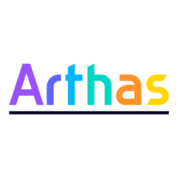

# Arthas Docs uTools Plugin



## 📖 项目介绍

Arthas Docs uTools Plugin 是一个基于 [uTools](https://u.tools/) 平台的插件，为 Java 开发者提供了 [Alibaba Arthas](https://arthas.aliyun.com/) 诊断工具的离线文档查询功能。该插件集成了 Arthas 4.0.4 版本的完整文档，让开发者能够随时随地查阅 Arthas 的命令用法、功能特性和使用案例，无需联网即可获取所需信息。

Arthas 是阿里巴巴开源的 Java 应用诊断工具，广泛应用于线上问题排查、性能分析和系统监控。本插件旨在提高开发者使用 Arthas 的效率，通过优化的界面和便捷的文档访问方式，帮助用户快速掌握 Arthas 的各项功能。

## ✨ 主要特性

- **完整文档集成**：包含 Arthas 4.0.4 版本的全部命令和功能文档
- **离线使用**：无需网络连接，随时查阅文档
- **优化的阅读体验**：
  - 响应式设计，适配不同屏幕尺寸
  - 代码块语法高亮
  - 自动文本换行，提高可读性
  - 表格内容优化显示
- **快速检索**：通过 uTools 关键词 "arthas"、"docs" 或 "java诊断" 快速启动
- **暗黑模式支持**：自动适配系统主题设置
- **界面交互优化**：
  - 可调整侧边栏宽度
  - 命令分类清晰展示
  - 文档内容格式优化

## 🔧 技术架构

### 核心组件

1. **前端界面**：
   - HTML5 + CSS3 构建的响应式界面
   - 纯 JavaScript 实现的交互逻辑，无框架依赖
   - 分离的侧边栏和内容区域设计

2. **文档处理**：
   - 使用 Marked.js 解析 Markdown 文档
   - 自定义渲染器增强代码块显示
   - 文档内容动态加载机制

3. **uTools 集成**：
   - 基于 uTools 插件 API 开发
   - 利用 Node.js 能力读取本地文件
   - 插件生命周期管理

### 文件结构

```
arthas/
├── docs/                 # Arthas 文档 Markdown 文件
├── index.html            # 主界面 HTML
├── index.js              # 主要 JavaScript 逻辑
├── style.css             # 样式表
├── preload.js            # uTools 预加载脚本
├── plugin.json           # 插件配置文件
├── docs-list.json        # 文档列表和描述
├── logo.png              # 插件图标
├── package.json          # 项目依赖配置
└── README.md             # 项目说明文档
```

## 🚀 功能模块

### 1. 文档浏览

- **命令列表**：展示所有 Arthas 命令及其简要描述
- **命令详情**：提供每个命令的详细用法、参数说明和使用示例
- **核心功能**：包含 Arthas 的核心功能文档，如类增强、表达式支持等

### 2. 界面交互

- **侧边栏调整**：可拖动分隔条调整侧边栏宽度
- **版本切换**：支持未来扩展多版本文档切换功能
- **通知系统**：提供操作反馈的通知机制

### 3. 代码展示

- **语法高亮**：支持多种语言的代码高亮显示
- **特殊标记**：对 Arthas 命令、选项等进行特殊标记
- **自适应显示**：代码块水平滚动，保持格式完整性

## 📋 命令列表

插件包含以下 Arthas 命令的详细文档：

| 基础命令 | 类相关 | 方法相关 | 增强相关 | 系统相关 |
|---------|-------|---------|---------|---------|
| help    | sc    | sm      | watch   | dashboard |
| cls     | jad   | trace   | monitor | thread    |
| session | dump  | stack   | tt      | jvm       |
| reset   | mc    |         | profiler| sysenv    |
| version | redefine |      |         | vmoption  |
| quit    | retransform |   |         | sysprop   |
| stop    | classloader |   |         | perfcounter |

此外，还包括 HTTP API、批处理支持、鉴权等高级功能的文档。

## 🔍 使用方法

1. 在 uTools 中安装 Arthas Docs 插件
2. 通过关键词 "arthas"、"docs" 或 "java诊断" 启动插件
3. 在左侧菜单中选择需要查看的命令或功能
4. 在右侧内容区域阅读详细文档

## 🛠️ 开发与构建

### 环境要求

- Node.js 18.0 或更高版本
- uTools 开发者工具

### 安装依赖

```bash
npm install
```

### 开发调试

1. 使用 uTools 开发者工具加载项目目录
2. 修改代码后刷新插件进行测试

### 构建插件

```bash
# 打包插件
uTools build
```

## 📄 许可证

本项目采用 MIT 许可证。详见 [LICENSE](LICENSE) 文件。

## 🔗 相关链接

- [Arthas 官方文档](https://arthas.aliyun.com/doc/)
- [uTools 官网](https://u.tools/)
- [Alibaba Arthas GitHub](https://github.com/alibaba/arthas)

---

**注意**：本插件为非官方 Arthas 文档工具，仅用于学习和参考。如有任何问题，请参考 Arthas 官方文档。
